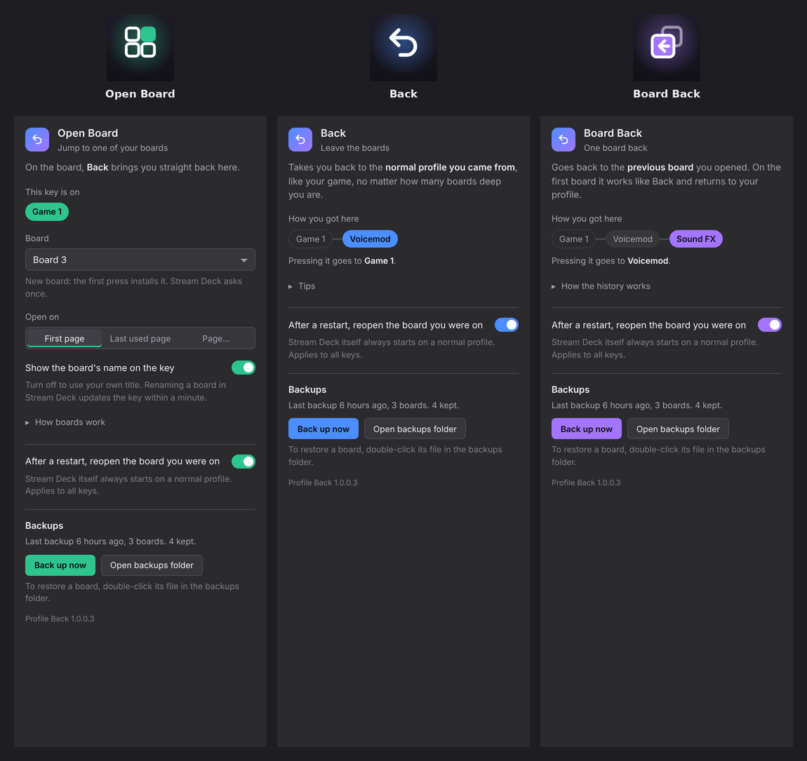
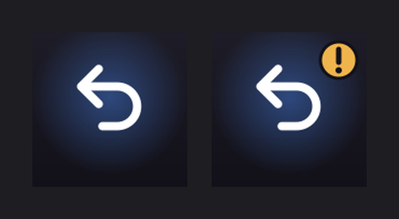

# Profile Back

**A "go back" key for Stream Deck.** Open a shared board, like your soundboard, from any game profile, and get back to exactly the profile you came from with one press.



## Why

Stream Deck has no "back to the previous profile". If you want one Voicemod soundboard reachable from five game profiles, the soundboard needs five "go back to Game 1…5" keys, and you have to remember which one to press.

Profile Back fixes that with **boards**: profiles that can be opened from anywhere and always know the way back.

```
Game 1 ──Open Board──▶ Voicemod ──Back──▶ Game 1
Game 2 ──Open Board──▶ Voicemod ──Back──▶ Game 2
```

## Features

- **Open Board**: opens one of your boards, on its first page, the page you last used, or a fixed page. Shows the board's name on the key and follows renames.
- **Back**: returns to the normal profile you came from, however many boards deep you are.
- **Board Back**: steps back one board at a time (`Game → Voicemod → Sound FX → Board Back → Voicemod`). No depth limit; the history survives restarts.
- **Reopen after restart**: Stream Deck always starts on a normal profile; Profile Back can reopen the board you were on (on by default).
- **Warning badge**: Back shows a small amber **!** when it won't do what you'd expect (see [Good to know](#good-to-know)).
- **Automatic backups** of your boards, restorable with a double-click.
- **100 boards per Stream Deck** for every model: 15-key (MK.2 / original), Mini, XL, +, Neo, + XL. Boards only appear in your profile list once you open them.

## Install

1. Download `com.caviarthecatgirl.profile-back.streamDeckPlugin` from the [latest release](../../releases/latest).
2. Double-click it. Stream Deck installs the plugin.

Requires Stream Deck **6.9** or newer. Tested on Stream Deck 7.5 and 7.6 on Windows 11 with a Stream Deck MK.2. macOS is supported by the plugin but untested.

## Quick start: one soundboard for all your games

1. On **Game 1**, drag **Open Board** (category *Profile Back*) onto a key. A new key picks the first unused board automatically.
2. Press it. Stream Deck asks once whether to install the board → **Install**. You're on *Board 1*, which already has a **Back** key at the top left.
3. In Stream Deck's **Preferences → Profiles**, rename *Board 1* to *Voicemod* and fill it with your sound keys. The Open Board key picks up the new name within a minute.
4. Put the same Open Board key (Board 1) on Game 2, Game 3, …
5. From any game: Open Board → play a sound → **Back** → you're back in that game.

**One press for both:** make a Stream Deck **Multi Action** of *your sound* + *Back*.

## The keys

| Key | Put it on | Does |
|---|---|---|
| **Open Board** | anywhere | Opens a board. Settings: which board, which page, show the board's name. |
| **Back** | a board | Back to the normal profile you came from. On a normal profile it only shows a warning triangle (Stream Deck doesn't allow it there). |
| **Board Back** | a board | Back to the previous board. On the first board of a chain it works like Back. |

Each key's settings panel shows where the key is and where pressing it will take you, e.g. *Game 1 — Voicemod — Sound FX: pressing it goes to Voicemod*.

## How boards work

A board is a normal Stream Deck profile that ships with this plugin. Add keys, pages and folders, rename it, export it: everything works like any other profile. The difference: a plugin may only switch to profiles it brought along, and Stream Deck's "previous profile" only works while one of them is on screen. Boards are what make Back possible.

- Boards are installed the first time you open them; unused boards never clutter your profile list.
- Renaming a board, updating the plugin, or even uninstalling and reinstalling it keeps your boards and their link to the plugin.
- Each deck model has its own 100 boards; two decks each get their own copies.
- A board you delete is offered again, empty, the next time an Open Board key opens it.

## Good to know

These come from how Stream Deck itself handles "previous profile" (measured on Stream Deck 7.6), not from the plugin:

- **Leave boards with Back.** Stream Deck remembers the profile you were on when a board was first opened, and forgets it only when Back is used. If you leave the boards another way (the app window, a native *Switch Profile* key), the next Back still goes to that older profile.
- **Boards opened from the app window** have nowhere to go back to; Back then shows Stream Deck's alert triangle.
- In both cases **Back and Board Back show an amber badge** beforehand, and the key's settings explain why.

  

- A key with **your own image** (set in Stream Deck) keeps it; the badge can't replace a custom image. The settings panel still shows the warning.

## Backups

Every installed board is saved as a `.streamDeckProfile` file in `%APPDATA%\ProfileBack\backups\` (macOS: `~/Library/Application Support/ProfileBack/backups/`):

- automatically when the plugin starts or a new version is installed, and hourly when something changed;
- on demand: **Back up now** in any key's settings;
- the newest 30 backups are kept.

**To restore a board**, double-click its file. Stream Deck imports it (the name may get a *Copy* suffix); the copy keeps its link to the plugin and takes over that board number, so your Open Board keys open it. Delete the old copy if it still exists.

## Privacy

- Profile Back only **reads** Stream Deck's profile folder: profile names, how many keys a page has, and its own keys. It never writes there, and never reads other plugins' settings.
- It stores its own small files in the data folder above: board history (`history.json`), options (`options.json`) and backups.
- No network access, no telemetry.

## Building from source

Requires Node.js 20+.

```sh
npm ci
npm run build    # generates the board pool and manifest profiles, then bundles bin/plugin.js
npm test         # runs the built plugin against a simulated Stream Deck (needs `unzip`)
```

Package with the [Elgato CLI](https://docs.elgato.com/streamdeck/cli/intro): `npx streamdeck pack com.caviarthecatgirl.profile-back.sdPlugin`.

| Path | |
|---|---|
| `src/actions/` | Open Board, Back, Board Back, on a shared base (presses, Multi Actions, settings panel, badge) |
| `src/navigator.ts` | where the deck is, board history, Stream Deck's memory, switching, reopen after restart |
| `src/boards.ts`, `src/keys.ts`, `src/scan.ts` | board pool, key → profile lookup, read-only profile scan |
| `src/backups.ts` | automatic and manual backups |
| `*.sdPlugin/ui/` | settings panels (plain HTML/CSS/JS, no external libraries) |
| `scripts/make-profiles.mjs` | writes the bundled boards + the manifest's `Profiles` list (runs during build) |
| `scripts/make-icons.mjs` | renders all images from SVG (needs `sharp`; output is committed) |
| `test/fake-deck.mjs` | 52 end-to-end checks against a fake Stream Deck |

**The board pool may only grow.** `boards.lock.json` records the highest board count ever shipped and the build refuses fewer: shrinking would cut boards people already use off from the plugin.

## License

[MIT](LICENSE) © 2026 CaviarTheCatgirl
